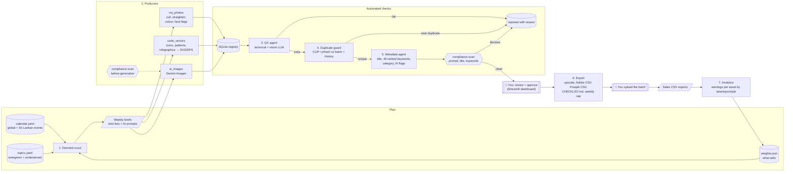

# Stock Studio

An agent pipeline for running **Adobe Stock** and **Freepik** contributor accounts profitably and within
their rules. It automates the business side (deciding what to make, quality control, duplicate
checks, keywording, compliance, export and sales tracking) and leaves the final decision to you:
**nothing is uploaded until you approve it, and the tool never uploads anything itself.**

Why not mass generation: stock sites are flooded with AI images and are pushing back. Adobe Stock
accepts generative AI only when it's labelled, bans artist names, real people, brands and
copyrighted works in prompts, titles and keywords, and rejects near-identical variations. Contributors
also report that weekly upload limits shrink when approval rates drop. So this pipeline aims for
fewer, better files with a high approval rate.

## Architecture



| Step | Module | What it does |
|---|---|---|
| 1 | `scout/demand.py` | Scores events 30-120 days out (buyers search 1-3 months ahead), with a supply-gap bonus for Sri Lankan and South Asian events, plus evergreen and underserved topics, multiplied by your sales weights. Writes `workspace/briefs/<week>.md/.json`. |
| 2a | `producers/my_photos.py` | Ingests a phone folder (photos + videos). Culls blurry frames and burst duplicates (keeps the sharpest), auto-straightens horizons, light white balance and levels, flags faces as needing a release, strips GPS. Originals are never touched. |
| 2b | `producers/code_vectors.py` | Original vector art from code: 7 icon sets (50+ hand-built icons, outline/filled/duotone, 7 palettes), 9 seamless pattern motifs (lotus, kolam, lanterns, leaves, waves...), and 4 infographic layouts. Outputs SVG master, EPS and a JPEG preview of 4 MP or more. |
| 2c | `producers/ai_images.py` | Gemini Imagen, one image per prompt. Prompts are compliance-scanned **before** they're sent; a blocked prompt is never generated. |
| 3 | `qc/agent.py` | Technical checks (platform minimum sizes, sharpness, clipping, video length and size), then a vision LLM check for anatomy errors, garbled text, logos, watermarks, artifacts, real-person resemblance and property. Rejects with a reason. If no vision model is available, AI images wait instead of passing. |
| 4 | `dedupe/guard.py` | CLIP embeddings (CPU) or a perceptual-hash fallback. Blocks near-duplicates within a batch and against everything pending, approved, exported, or indexed from your past uploads. |
| 5 | `metadata/agent.py` + `compliance.py` | Title, up to 49 keywords ranked by relevance (Adobe weights the first ones most), Adobe category, AI-generated and fictional flags. Banned keywords are dropped automatically; a banned title or prompt stops the asset. |
| 6 | `export/exporter.py` | Approved assets only. Upscales up to 2x if below the minimum (refuses beyond that), writes the Adobe CSV, the Freepik CSV and `CHECKLIST.md`, and splits into batches under your weekly cap. |
| 7 | `analytics/sales.py` | Imports sales CSVs, matches sales to assets by filename or title, reports earnings per asset by lane, topic and style, and writes `weights.json` for the scout. |

## Setup

Runs on a 16 GB laptop with no GPU (CLIP runs fine on CPU).

```bash
python -m venv .venv && source .venv/bin/activate
```

```bash
pip install -e ".[gemini,clip,dev]"
```

```bash
cp .env.example .env
```

Then put your `GEMINI_API_KEY` in `.env`. The Gemini free tier covers the QC and metadata agents.
Imagen (the AI image lane) is a paid API feature; check Google's current terms for commercial use
before selling its output. To use Claude or OpenAI for QC and metadata instead, install `.[claude]` or
`.[openai]` and set `LLM_PROVIDER`. With `LLM_PROVIDER=offline` everything runs without any API: only
the technical QC runs, and the metadata is a template draft you edit in review.

You also need the Cairo library for SVG→EPS/JPEG (`brew install cairo` on macOS, `apt install libcairo2` on
Debian/Ubuntu; on Windows the GTK runtime provides it).

## Weekly workflow

```bash
python -m stock_studio scout                       # 1. what to make this week (add --llm to expand shot lists)
```

```bash
python -m stock_studio history ~/Pictures/already-uploaded   # once: index past uploads for the duplicate guard
```

```bash
python -m stock_studio photos ~/DCIM/2026-11-vesak --topic "Vesak"   # 2a. your shoot
```

```bash
python -m stock_studio vectors icons --sets festival travel --styles 1   # 2b
```

```bash
python -m stock_studio vectors patterns --count 6
```

```bash
python -m stock_studio ai --brief workspace/briefs/2026-W45.json        # 2c. prompts from the AI-lane briefs
```

```bash
python -m stock_studio process                     # 3-5. QC → duplicate guard → metadata
```

```bash
streamlit run app/dashboard.py                     # review, edit, approve / reject
```

```bash
python -m stock_studio export                      # 6. batches in workspace/exports/<week>/<platform>/
```

Upload each batch folder, import its CSV, and work through `CHECKLIST.md`: it lists which files need
*Created using generative AI tools*, *People and property are fictional*, or a model/property release
attached. Adobe's CSV has no columns for these flags, so they must be set in the upload form.

```bash
python -m stock_studio sales ~/Downloads/adobe_sales.csv --platform adobe   # 7. feed results back
```

```bash
python -m stock_studio report
```

If your sales CSV has unusual column names: `--map earnings="Royalty (USD)" filename="Original name"`.

## Configuration

`config.yaml` holds the weekly cap (default **100** per platform), batch size, platform minimums, QC
and duplicate thresholds, and scout lookahead. `stock_studio/data/` holds the event calendar, topic
lists and the banned-terms list; extend all three. Lunar festivals (Vesak, Poson, Eid, Deepavali,
Holi) move every year and are marked "approx — confirm date" in briefs.

## Verify before your first bulk upload

Platform rules change, and these points weren't confirmed against live contributor portals:

- **Freepik metadata CSV columns.** The contributor site now redirects to Magnific branding. Compare
  `platforms.freepik.csv_columns` and `csv_delimiter` with the template in your dashboard, and check
  the current AI rules there.
- **Vector formats.** Adobe batches contain `.eps` plus a same-name `.jpg` preview; Freepik batches
  contain a `.zip` of both. Cairo writes EPS 3.0. If a portal rejects it, open the SVG master in
  Inkscape or Illustrator and re-save as EPS 10.
- **Minimum sizes and video limits.** These are in `config.yaml` (Adobe 4 MP, Freepik 2000 px shortest
  side, video 5-60 s, at least 720p). Adjust them if the portals say otherwise.
- **Weekly limits.** Keep `weekly_cap` well below the limit your portal shows.

## Tests

```bash
pytest
```

The 62 tests cover the compliance scanner (brands, artists, real people, characters, joined and
possessive spellings, no false hits like *pineapple*), the duplicate guard (resized, re-exposed,
cropped and recompressed copies caught, distinct images kept, history and approved assets used as
reference), photo culling and straightening, seamless pattern edges, the scout window and weights,
the export cap, CSVs and upscaling, the sales import, and the full AI lane with a fake LLM (a banned
prompt is never sent, an anatomy defect is rejected, a banned keyword is stripped).

## Project layout

```
stock_studio/
  scout/demand.py          1. demand scout
  producers/               2. my_photos, code_vectors (+ vector_icons), ai_images
  qc/agent.py              3. QC agent
  dedupe/guard.py          4. duplicate guard
  metadata/                5. metadata agent + compliance scanner
  export/exporter.py       6. batch export
  analytics/sales.py       7. sales feedback loop
  llm/                     Gemini / Claude / OpenAI / offline providers
  data/                    calendar, topics, banned terms
  pipeline.py, cli.py, store.py
app/dashboard.py           Streamlit review dashboard
workspace/                 runtime data (git-ignored): db, assets, briefs, exports, analytics
```
